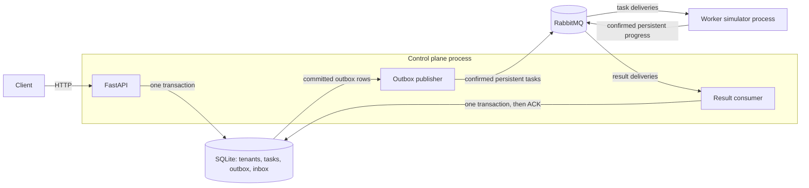

# Tenant provisioning control plane

A Python service with a REST API, durable task publication, a result consumer,
and a separate worker simulator. SQLite owns the state; RabbitMQ carries tasks
and progress. Everything runs locally in Docker Compose.

## Run from a cold checkout

Prerequisites: Docker with Compose v2 or newer and GNU Make. No host Python,
database, broker, account, or credentials are needed.

```sh
# From the root of this repository:
make up       # build and start the broker, API, and worker; wait for readiness
make test     # formatter, linter, security scanner, unit + real-broker tests
make smoke    # live HTTP lifecycle plus 12 concurrent PATCH requests
```

- API: <http://localhost:8000>
- Interactive API documentation: <http://localhost:8000/docs>
- OpenAPI: <http://localhost:8000/openapi.json>
- RabbitMQ management: <http://localhost:15672> (built-in local `guest` / `guest`)

`make test` builds a separate test image and runs an isolated RabbitMQ container.
It cleans up its own containers and volumes on exit and does not touch the running
application. The test command fails on formatting, Ruff lint, Bandit security
findings, failed tests, or core application coverage below 85%.

```sh
make logs                   # follow API and worker logs
docker compose ps
make down                   # stop; preserve tenant and broker volumes
make up                     # existing tenants survive
# Only when intentionally resetting all local application data:
docker compose down -v
```

Override occupied ports with `API_PORT=8080 BROKER_UI_PORT=15673 make up`.
The API and management ports bind only to loopback. AMQP is accessible inside the
Compose network. The built-in guest account and relaxed guest loopback restriction
are for this local assignment; this configuration is not a production deployment.
There are no private credentials in the repository.

## Architecture



`make up` deploys one Compose application with three services. The control plane
contains the HTTP API, one publisher thread, and one result-consumer thread; each
broker thread owns a separate AMQP connection. The worker runs in another
container/process and never accesses SQLite.

### State and concurrency

- New tenants start at `provisioning`, version `1`; their deploy task is `accepted`.
- `PATCH` is allowed only from `active`; it changes the name, moves the tenant to
  `updating`, increments its version, and creates an update task.
- `DELETE` is allowed from `active` or `failed`; it moves the tenant to `destroying`,
  increments its version, and creates a destroy task. This is asynchronous logical
  deletion, so destroyed tenants remain readable and their slugs remain reserved.
- Task transitions are `accepted -> in_progress -> done|failed`. A successful
  deploy/update makes the tenant `active`; a successful destroy makes it
  `destroyed`; any failed task makes it `failed`.
- A terminal result increments the tenant version once. Moving only the task to
  `in_progress` does not mutate the tenant and does not increment its version.
- Tenant changes, task creation, and outbox insertion are one transaction.
  `BEGIN IMMEDIATE` reserves SQLite's writer before reading status/version.
  Two matching-version PATCH requests therefore cannot both succeed. Version
  conflict is checked before the state guard, so the losing PATCH gets
  `tenant_version_conflict`, even if the winner already moved the tenant.
- The unique database constraint on `slug` selects exactly one concurrent create
  winner. Tenant state guards prevent multiple open tasks; there is no separate
  per-tenant task lock.

All timestamps use UTC ISO 8601 with exactly three fractional digits and `Z`.
Slugs are immutable and follow the assignment's 3–28 character expression.
Names are trimmed, non-empty strings, limited to 200 characters. `name` is the
only editable field; PATCH requires it and the current integer `version`.
Unknown body fields are rejected, including attempts to set status or change slug.

### Durable messaging and failure windows

**Outbound:** one immutable outbox record per task, keyed by task ID, is inserted
inside the API transaction. The publisher reads only committed rows, uses persistent
AMQP messages with publisher confirms and mandatory routing, and marks the row
published only after confirmation. A rollback produces no task or event. The
HTTP response means the operation is durably accepted, even during broker downtime.

There is exactly one **logical** event for every accepted mutation. Physical
delivery is **at least once**: a crash after RabbitMQ confirms but before the outbox
is marked can republish the same event ID. Claiming exactly one physical publication
across two independent systems would be incorrect. The worker regenerates stable
progress IDs on redelivery, and the result consumer deduplicates them durably.

**Inbound:** each progress UUID is recorded in the inbox in the same transaction
as task/tenant changes. ACK happens only after commit. Duplicate IDs are no-ops;
reusing an ID with a different task or status is rejected as poison. Any fresh
update for a terminal task is recorded as ignored, so an old task cannot affect
a newer operation on the same tenant.

If a terminal result arrives while the task is still `accepted`, it is stored as
pending and ACKed. The later `in_progress` update applies the start and the pending
terminal outcome atomically, maintaining the exact state machine. The first
terminal receipt wins if conflicting terminal results arrive. Pending receipts
survive restarts. This relies on the worker eventually delivering `in_progress`;
a manually injected terminal result alone deliberately leaves the task accepted.

Invalid JSON/schema, unknown tasks, and conflicting event identities are NACKed
without requeue and routed to a durable dead-letter queue. Transient database or
AMQP errors leave deliveries unacknowledged, close the connection, and reconnect
with exponential backoff (250 ms to 10 seconds, plus jitter). The worker ACKs its
task only after both progress publications have been confirmed. Its simulated
delay services AMQP heartbeats and responds to termination signals.

The retry and delivery design follows the upstream descriptions of
[RabbitMQ acknowledgements and confirms](https://www.rabbitmq.com/docs/confirms),
[SQLite transactions](https://www.sqlite.org/lang_transaction.html), and
[Pika's blocking connection](https://pika.readthedocs.io/en/stable/modules/adapters/blocking.html).

## HTTP contract

| Method and resource | Success | Behavior |
| --- | --- | --- |
| `POST /tenants` | 202 | Create tenant and accepted deploy task; `Location` points to tenant |
| `GET /tenants` | 200 | List tenants, including destroyed ones |
| `GET /tenants/{id}` | 200 | Get one tenant |
| `PATCH /tenants/{id}` | 202 | Update name with required current `version`; enqueue update |
| `DELETE /tenants/{id}` | 202 | Enqueue destroy; no body or version required |
| `GET /tasks` | 200 | List tasks |
| `GET /tasks/{id}` | 200 | Get one task |
| `GET /health/live` | 200 | HTTP process is alive |
| `GET /health/ready` | 200 / 503 | Database readable and both broker threads connected |

Mutating calls return `{"tenant": {...}, "task": {...}}`. Detail calls return the
resource directly. Tasks have no HTTP write endpoints. IDs are UUIDs; malformed
IDs fail validation while well-formed unknown IDs return the matching not-found code.

Lists accept `limit` (1–100, default 50), `offset` (default 0), and `status`.
`GET /tasks` also accepts `tenant_id`. They return:

```json
{"items": [], "limit": 50, "offset": 0, "next_offset": null}
```

Ordering is `created_at, id` ascending. `next_offset` is null on the last page.
Offset pagination is intentionally simple and is not a snapshot under concurrent
inserts. Filtering tasks by an unknown tenant returns an empty list.

Every application error uses this envelope:

```json
{"error": {"code": "tenant_version_conflict", "message": "Version does not match current tenant"}}
```

| HTTP | Code | Meaning |
| --- | --- | --- |
| 404 | `tenant_not_found` | Unknown tenant |
| 404 | `task_not_found` | Unknown task |
| 409 | `tenant_already_exists` | Slug already reserved, including destroyed tenants |
| 409 | `tenant_update_not_allowed` | PATCH/DELETE forbidden in current state |
| 409 | `tenant_version_conflict` | PATCH's version is stale |
| 422 | `validation_error` | Invalid body, ID, query, or unknown body fields |
| 404 / 405 | `http_error` | Unknown route or unsupported method |
| 503 | `service_unavailable` | Database unavailable or readiness still recovering |
| 500 | `internal_error` | Unexpected error; details stay in server logs |

### Try the API

These examples use `jq` only to extract IDs; the service and test commands do not
require it.

```sh
BASE=http://localhost:8000
CREATED=$(curl -fsS -X POST "$BASE/tenants" \
  -H 'Content-Type: application/json' -d '{"slug":"acme-prod","name":"Acme"}')
echo "$CREATED" | jq
TENANT_ID=$(echo "$CREATED" | jq -r .tenant.id)
TASK_ID=$(echo "$CREATED" | jq -r .task.id)
curl -fsS "$BASE/tasks/$TASK_ID" | jq
curl -fsS "$BASE/tasks?tenant_id=$TENANT_ID" | jq
curl -fsS "$BASE/tenants/$TENANT_ID" | jq

# Wait until GET shows active. The default worker takes 1–2 seconds.
# This loop works with custom delays too:
until [ "$(curl -fsS "$BASE/tenants/$TENANT_ID" | jq -r .status)" = active ]; do sleep 1; done
VERSION=$(curl -fsS "$BASE/tenants/$TENANT_ID" | jq -r .version)
curl -fsS -X PATCH "$BASE/tenants/$TENANT_ID" \
  -H 'Content-Type: application/json' \
  -d "{\"version\":$VERSION,\"name\":\"Acme renamed\"}" | jq

until [ "$(curl -fsS "$BASE/tenants/$TENANT_ID" | jq -r .status)" = active ]; do sleep 1; done
curl -fsS -X DELETE "$BASE/tenants/$TENANT_ID" | jq
curl -fsS "$BASE/tenants?status=destroying&limit=10" | jq
```

## Reproduce negative scenarios

### Restart the simulator with failures, delays, or reordered duplicates

Use `up --force-recreate`, because `docker compose restart` does not update
environment variables:

```sh
WORKER_FAIL_RATE=1 WORKER_MIN_DELAY_MS=3000 WORKER_MAX_DELAY_MS=5000 \
  docker compose up -d --no-deps --force-recreate worker
# POST a new tenant: deploy ends failed. DELETE is allowed from failed.

WORKER_DUPLICATE_UPDATES=1 WORKER_OUT_OF_ORDER=1 \
  docker compose up -d --no-deps --force-recreate worker
# POST a new tenant: terminal-before-start + duplicates still yield active, version 2.

# Restore normal behavior (defaults apply to a fresh shell without WORKER_* exports):
WORKER_FAIL_RATE=0 WORKER_DUPLICATE_UPDATES=0 WORKER_OUT_OF_ORDER=0 \
  docker compose up -d --no-deps --force-recreate worker
```

The equivalent CLI flags are `--fail-rate`, `--min-delay-ms`, `--max-delay-ms`,
`--duplicate-updates`, `--out-of-order`, and `--seed`. Outcomes use a deterministic
hash of task ID and seed, so redelivery under the same configuration does not
reroll success/failure. Configuration changes affect reprocessed work; the control
plane always preserves the first terminal result.

### Publish duplicates, out-of-order results, and poison directly

Stop the worker, create a new tenant, and copy its task UUID into `TASK_ID`:

```sh
docker compose stop worker
# POST /tenants as above, with a fresh slug; set TASK_ID from the response.

# Terminal arrives first and is retained pending. --repeat uses one event ID.
docker compose exec -T api python -m control_plane.inject \
  --task-id "$TASK_ID" --status done --repeat 2
# The task is still accepted until this start event arrives:
docker compose exec -T api python -m control_plane.inject \
  --task-id "$TASK_ID" --status in_progress --repeat 2
# The task is now done; tenant active. A later failure cannot regress it:
docker compose exec -T api python -m control_plane.inject \
  --task-id "$TASK_ID" --status failed

docker compose exec -T api python -m control_plane.inject --raw 'not-json'
docker compose exec -T api python -m control_plane.inject --queue control.tasks --raw '{}'
docker compose start worker
docker compose exec -T broker rabbitmqctl list_queues name messages_ready messages_unacknowledged
```

`--event-id <UUID>` lets you replay an exact message after restarting the injector.
RabbitMQ management also allows inspection/publication without application tooling.

### Broker outage and persistence

```sh
docker compose stop broker
# POST a fresh tenant: HTTP 202; task remains accepted in the durable outbox.
# /health/ready returns 503 once the dropped connections are detected.
docker compose start broker
# API and worker reconnect automatically; pending tenant eventually becomes active.
docker compose restart api
# GET the same tenant: it survives the restart with the same version and task history.
```

Queue names are `control.tasks` and `control.results`; their poison messages route
through exchange `control.dead` into `control.tasks.dead` and `control.results.dead`.
All queues/exchanges are durable. The schemas are:

```json
{
  "schema_version": 1,
  "id": "<task UUID>", "type": "deploy", "tenant_id": "<tenant UUID>",
  "status": "accepted", "created_at": "2026-11-02T12:00:00.000Z",
  "updated_at": "2026-11-02T12:00:00.000Z"
}
```

```json
{"schema_version": 1, "id": "<stable progress UUID>", "task_id": "<task UUID>", "status": "in_progress"}
```

The progress status is `in_progress`, `done`, or `failed`; a task event's type is
`deploy`, `update`, or `destroy`. RabbitMQ's `message_id` mirrors the JSON ID.
The JSON ID is authoritative for deduplication.

## Tests and code guide

- `control_plane/db.py`: state machine, transactional writes, durable outbox/inbox.
- `control_plane/api.py`: REST routes, validation and consistent error envelopes.
- `control_plane/broker.py`: topology, publish confirms, acknowledgements, retries.
- `control_plane/worker.py`: simulator CLI and stable progress identities.
- `tests/test_state.py`: every terminal transition, guards, races, rollback and replay.
- `tests/test_api.py`: HTTP contract, validation, pagination, concurrent request handlers.
- `tests/test_broker.py`: confirm failure/crash windows, ACK order, poison and backoff.
- `tests/test_integration.py`: real RabbitMQ with a separate worker process, full
  lifecycle, restart persistence, reordering, duplicates, redelivery and poison queues.
- `make smoke`: live TCP HTTP requests against the running Compose application.

For quick development outside containers, install Python 3.13+ and
[uv](https://docs.astral.sh/uv/), then run:

```sh
uv sync --frozen
uv run pytest -m 'not integration' -q
make format
```

The complete required gate remains `make test`. The lockfile pins all Python
dependencies. CI runs the same containerized gate on push and pull request.

### Local verification — 2 November 2026

The containerized gate passed **83 tests**, with **96.57% core-code statement
coverage** (the database, HTTP API, and broker module each reached 100%). Ruff's
formatter/linter and Bandit passed. A harmless Starlette/httpx deprecation warning
remains in the test client; it does not affect the running HTTP service.

`make smoke` passed against the running containers: all three tasks completed,
the final tenant version was 6, and 12 concurrent PATCHes produced one acceptance
and 11 conflicts. Additional live checks confirmed that an already queued task
survives `docker compose down` followed by `up`, a tenant accepted while the broker
is stopped completes after it restarts, and an API restart preserves the resource.

## Deliberate limits and trade-offs

- SQLite WAL with full synchronous commits is sufficient for this single-instance
  local service. Writes serialize; reads can proceed alongside writes. Five-second
  lock exhaustion returns a structured 503. Use PostgreSQL with row-level locking
  and claimed outbox batches before scaling API replicas; run one API process and
  one outbox publisher in this version.
- Single-node RabbitMQ plus named volumes provides restart durability, not high
  availability. Classic-queue dead lettering has a failure window if the target
  queue is unavailable. Replicated quorum queues with at-least-once dead lettering
  would be appropriate for a production deployment.
- No authentication, real provisioning side effects, cancellation, automatic
  failed-task retry, inbox/outbox retention, or schema upgrade framework. These
  are beyond this assignment. Failed tenants can be destroyed; deleted slugs are
  never reused. Name changes are accepted before simulated work and are retained
  if the task fails.
- Worker redelivery may repeat simulated work. Real infrastructure provisioning
  must also be idempotent by task ID; database result deduplication alone cannot
  make an external side effect exactly once.
- HTTP POST retries are not keyed by a client idempotency header. A duplicate slug
  returns the contracted conflict; clients can inspect the tenant list to reconcile.

This directory is self-contained for a public repository. Publishing or sending
it externally is a separate submission step; running any command above stays local.
